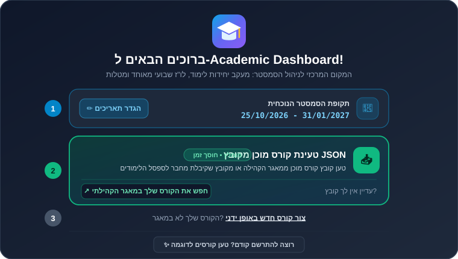
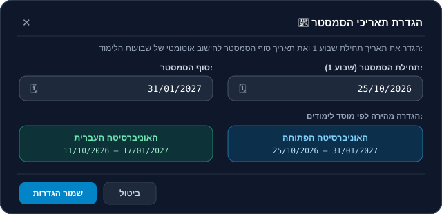
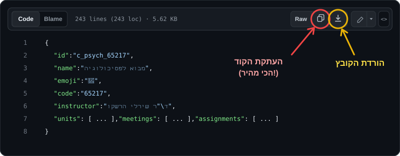
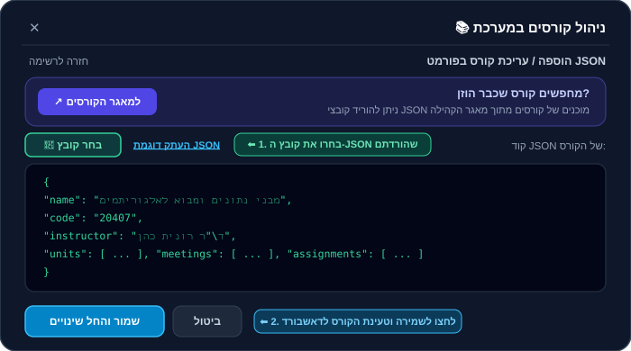
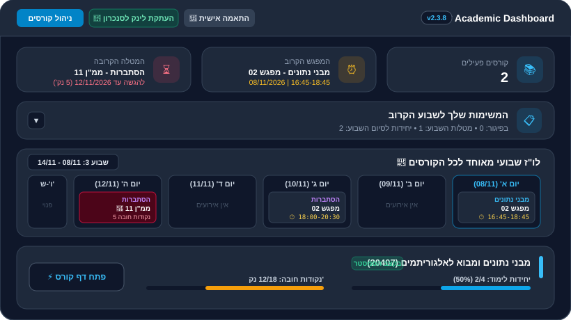

# 📖 מדריך למשתמש: הקמה והגדרה של המערכת מאפס

ברוכים הבאים ל-**Academic Dashboard**! 🎓  
המדריך הזה נכתב במיוחד כדי שתוכלו להקים, להגדיר ולהתחיל להשתמש במערכת תוך **פחות מ-3 דקות** — **ללא צורך בידע טכני, בהתקנה או בהרשמה**.

---

## שלב 1: כניסה ראשונית למערכת

1. פתחו את **[קישור המערכת](https://klempor.github.io/academic-dashboard/)** בדפדפן שלכם (במחשב או בטלפון הנייד).
2. בכניסה הראשונה יופיע מולכם **מסך הפתיחה** המסודר לפי 3 שלבים פשוטים:

1. **הגדרת תקופת הסמסטר** — וידוא שתאריכי תחילה וסיום הסמסטר תואמים למוסד הלימודים שלכם.
2. **טעינת קורס מוכן מקובץ JSON (הדרך המומלצת)** — טעינה מהירה של קורס שכבר הוזן במאגר הקהילה.
3. **יצירת קורס ידנית (אפשרות חלופית)** — במידה שהקורס שלכם עדיין לא מופיע במאגר.

> 🔒 **פרטיות מלאה:** אין צורך ליצור חשבון או להזין סיסמה. כל הנתונים שתזינו נשמרים באופן פרטי ומקומי בדפדפן שלכם בלבד.

---

## שלב 2: הגדרת תאריכי הסמסטר (שבוע 1 עד סוף הסמסטר)

הגדרת תאריכי הסמסטר מאפשרת למערכת לחשב אוטומטית באיזה שבוע לימוד אתם נמצאים, לבנות את הלו"ז השבועי, ולהתריע אם נוצר פער בקצב הלימוד.

1. במסך הפתיחה (או דרך כפתור **"הגדרות סמסטר"** בסרגל העליון), לחצו על **✏️ הגדר תאריכים**.
2. בחלון שנפתח תוכלו לבחור בלחיצה אחת את התאריכים המוכנים של מוסד הלימודים שלכם, או להזין תאריכים מותאמים אישית:
   * **האוניברסיטה הפתוחה:** `25/10/2026` עד `31/01/2027` (מוגדר כברירת מחדל).
   * **האוניברסיטה העברית:** `11/10/2026` עד `17/01/2027`.
3. לחצו על **שמור הגדרות**.

---

## שלב 3: הוספת הקורסים שלכם

ישנן שתי דרכים להוסיף קורסים למערכת — **מומלץ להתחיל באפשרות א'** כדי לחסוך זמן הקלדה:

### אפשרות א': טעינת קורס מוכן ממאגר הקהילה (מומלץ • חוסך זמן!)

סטודנטים אחרים כבר הזינו ושיתפו קובצי קורסים מוכנים הכוללים את כל המפגשים, יחידות הלימוד ותאריכי ההגשה של המטלות.

#### צעד 1: העתקת קוד הקורס או הורדת הקובץ מהמאגר
1. לחצו על הקישור **"חפש את הקורס שלך במאגר הקהילתי"** (תיפתח לשונית חדשה ב-GitHub).
2. היכנסו לתיקיות לפי: **מוסד לימודים ⬅️ שם הקורס ⬅️ קבוצת הלימוד שלכם**, ולחצו על הקובץ (בעל סיומת `.json`).
3. בפינה הימנית העליונה של תיבת הקוד בחרו באחת משתי הדרכים הנוחות לכם:
   * **להעתקת הקוד (הכי מהיר!):** לחצו על אייקון ההעתקה (העיגול האדום בתמונה — שני ריבועים חופפים) כדי להעתיק את כל קוד ה-JSON ללוח.
   * **להורדת הקובץ:** לחצו על אייקון ההורדה (העיגול הצהוב בתמונה — חץ כלפי מטה) ושמרו את הקובץ במחשב או בטלפון:

#### צעד 2: טעינת הקורס לתוך הדאשבורד
1. חזרו ללשונית של **Academic Dashboard** ולחצו על הכרטיסייה הירוקה **"טעינת קורס מוכן מקובץ JSON"** (אם כבר הוספתם קורס אחד, לחצו למעלה על **ניהול קורסים** ⬅️ **הוסף קורס מ-JSON**).
2. בחלון שנפתח:
   * **אם העתקתם את הקוד:** לחצו בתוך תיבת הטקסט השחורה והדביקו את הקוד (`Ctrl+V` במחשב או **הדבק** בנייד).
   * **אם הורדתם את הקובץ:** לחצו על כפתור **📁 בחר קובץ** ובחרו את הקובץ שהורדתם.
3. לחצו על **שמור והחל שינויים** — והקורס יופיע מיד בדאשבורד!

> 💡 **טיפ שימושי:** אם הקורס שלכם קיים במאגר אבל של קבוצת לימוד אחרת, מומלץ בכל זאת לטעון אותו! תקבלו מוכנים את כל יחידות הלימוד והמטלות, ותוכלו לעדכן בקלות רק את מועדי המפגשים של הקבוצה שלכם.

---

### אפשרות ב': יצירת קורס חדש באופן ידני

אם הקורס שלכם עדיין לא נמצא במאגר, תוכלו להקים אותו בקלות בעצמכם:

1. לחצו על **"צור קורס חדש באופן ידני"** (או דרך **ניהול קורסים** ⬅️ **הוסף קורס חדש**).
2. מלאו את פרטי הבסיס של הקורס:
   * **שם הקורס** וקוד הקורס.
   * **שם המנחה** וזמני המפגשים הכלליים.
   * **נקודות חובה נדרשות במטלות** (למשל `15` או `18` נקודות).
   * **צבע נושא** שיבדיל את הקורס בלו"ז השבועי.
3. לחצו על **שמור קורס**.
4. כעת לחצו על **⚡ פתח דף קורס** בכרטיסיית הקורס החדש והוסיפו בלחיצת כפתור:
   * **יחידות לימוד:** שם היחידה + מאיזה שבוע עד איזה שבוע מומלץ ללמוד אותה.
   * **מטלות:** שם המטלה, תאריך הגשה ומספר הנקודות שלה.
   * **מפגשים:** שם המפגש, תאריך ושעות.
   * **קישורים מהירים:** קישור לאתר הקורס, קישור לזום, דרייב וכדומה.

---

## שלב 4: היכרות עם מסך הבית וניהול שוטף

לאחר הוספת הקורסים, מסך הבית מרכז עבורכם את כל המידע החשוב במקום אחד:

### מה רואים במסך הראשי?
1. **כרטיסיות סיכום עליונות:** מציגות את מספר הקורסים הפעילים, את **המפגש הקרוב ביותר** ואת **המטלה הקרובה ביותר**.
2. **📋 המשימות שלך לשבוע הקרוב:** לחיצה על סרגל זה פותחת פירוט חכם המחולק ל-3 רשימות עדיפות:
   * **יחידות לימוד בפיגור בקצב** (כולל ציון השבוע שאליו שייכת היחידה וכמה שבועות איחור יש).
   * **מטלות להגשה בשבוע הקרוב** (התראות על מטלות להגשה היום, מחר או ב-7 הימים הקרובים).
   * **יחידות לימוד לסיום השבוע** (היחידות שמתוכננות להסתיים בשבוע הנוכחי).
3. **📅 לו"ז שבועי מאוחד:** מציג את כל המטלות (למעלה) והמפגשים (למטה) של כל הקורסים יחד.
   * **לחיצה על מטלה** מסמנת או מבטלת את הגשתה.
   * **לחיצה על מפגש** מסמנת או מבטלת את הנוכחות שלכם בו.
4. **כרטיסיות הקורסים שלי:** מציגות מד התקדמות ביחידות הלימוד, מד צבירת נקודות במטלות, תגית קצב למידה (*בקצב הסמסטר* / *מקדים את הקצב* / *פיגור*), וקישורים מהירים. לחיצה על **פתח דף קורס** פותחת את המסך המלא של הקורס כולל **מחשבון ציון משוקלל**.

---

## שלב 5: סנכרון בין מכשירים (מחשב ⇄ טלפון) וגיבוי

מכיוון שהנתונים נשמרים בדפדפן המקומי שלכם, הכנו דרך פשוטה להעביר את כל המידע שלכם בין המחשב לטלפון הנייד בלחיצת כפתור:

1. בסרגל העליון של המערכת, לחצו על כפתור **🔗 העתקת לינק לסנכרון**.
2. המערכת יוצרת ומעתיקה ללוח קישור מיוחד שמכיל בתוכו את כל הקורסים, הסימונים וההגדרות שלכם.
3. שלחו לעצמכם את הקישור (למשל בוואטסאפ לעצמכם או במייל) ופתחו אותו במכשיר השני — כל הנתונים ייטענו מיד!

> 💾 **גיבוי לקובץ:** בכל שלב תוכלו ללחוץ בסרגל העליון על **ניהול קורסים** ⬅️ **יצוא** כדי לשמור קובץ גיבוי של קורס במחשב, או על **גיבוי/יבוא** כדי לגבות את כל המערכת בבת אחת.

---

## ❓ שאלות נפוצות (FAQ)

* **האם המידע שלי נמחק כשאני סוגר את הדפדפן או כשהמערכת מתעדכנת?**  
  **לא.** כל המידע נשמר בזיכרון הקבוע של הדפדפן (`LocalStorage`) ונשאר שם גם לאחר סגירת הדפדפן, כיבוי המחשב או שדרוג גרסה של המערכת. (המידע יימחק רק אם תבצעו ידנית "ניקוי נתוני אתרים" בהגדרות הדפדפן).
* **האם סטודנטים אחרים רואים את הציונים או ההתקדמות שלי?**  
  **בשום אופן לא.** המערכת פועלת ב-100% אצלכם בדפדפן ואין לה שרת מרכזי שאוסף מידע.
* **איך משנים את צבעי המערכת?**  
  לחצו בסרגל העליון על **🎨 התאמה אישית** ובחרו אחת מ-6 ערכות הנושא המעוצבות.

בהצלחה בסמסטר! 🎓🚀